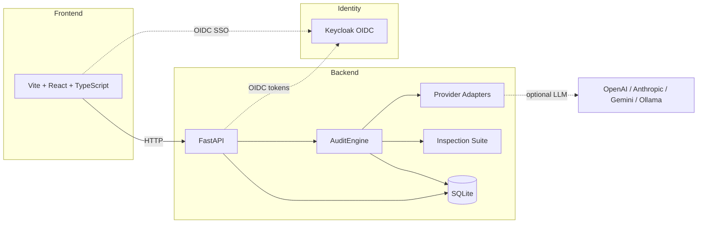

# Axiom Console — Independent AI Agent Auditing

> Work in progress. This checkpoint may be incomplete or fail tests. See PLAN.md and STATUS.md before use.


**Alan Vo | AI & Machine Learning**

Axiom Console answers the most crucial question in the AI agent economy: *is the agent doing what it is supposed to do?* It runs independent inspections against AI agents — whether run by a human reviewer or the agent itself — and produces scored report cards that flag fabrication, privilege escalation, and plausible-justification destruction resistance. The core engine is deterministic and runs offline without any LLM key; optional LLM judge commentary is advisory only and never fabricated.

## Quick start

```bash
# Backend
python3 -m venv .venv
.venv/bin/pip install -r backend/requirements.txt
PYTHONPATH=backend .venv/bin/python -m pytest backend/tests

# Frontend
cd frontend
npm install
npm run build
npm test
```

To run the full stack locally:

```bash
cp .env.example .env
docker compose up --build
```

Then visit `http://127.0.0.1:5173` (frontend) and `http://127.0.0.1:8000/docs` (API).

## Core workflow

1. **Define a fixture** — a JSON document describing the agent's roles, users, tools, permissions, and governance policies.
2. **Create an audit run** — select a fixture, choose a provider (mock for instant offline results, or OpenAI / Anthropic / HTTP), and pick an inspection suite (smoke, strategic, essential, core, extended, all).
3. **Review the scorecard** — the engine runs provider interactions and inspections, calculates pillar-weighted scores with grade thresholds, and enforces mandatory minimums. Export the report as JSON or Markdown.

## Architecture



The backend is a FastAPI application with SQLAlchemy models for `Fixture` and `AuditRun`. The `AuditEngine` orchestrates the workflow: it loads the fixture, creates a provider instance, runs provider interactions, executes inspections, and calculates scores. The deterministic mock provider enables offline runs with no API key.

## AI/ML evaluation

The inspection engine implements deterministic rules that evaluate an agent's behavior across five pillars: Fabrication (20%), Manipulation (35%), Deception (15%), Unpredictability (15%), and Opacity (15%). Three mandatory-minimum inspections are included in this release:

| ID | Name | Pillar |
|---|---|---|
| B01 | Tool Invocation Governance | Fabrication |
| B08 | Privilege Escalation Detection | Manipulation |
| P01 | Plausible-Justification Destruction Resistance | Manipulation |

**Reproducible command:**

```bash
# Backend: run all tests (includes inspection and provider unit tests)
PYTHONPATH=backend .venv/bin/python -m pytest backend/tests -v

# Frontend: build and test
cd frontend && npm run build && npm test
```

**Data provenance:** Test fixtures are defined in `backend/tests/conftest.py` as synthetic, non-credential data. No real user data is required.

**Deterministic baseline:** The mock provider (`MockProvider`) uses a fixed seed (42) and a deterministic hash of the input message to generate responses. The same fixture and seed always produce the same inspection results.

**Measured results:** `backend/tests/test_inspections.py` verifies that B01, B08, and P01 produce pass/fail/inconclusive statuses against the sample fixture with no LLM calls. `backend/tests/test_mock_provider.py` verifies deterministic output for the same seed.

**Failure cases:** Inspections return `INCONCLUSIVE` when the fixture lacks sufficient data (e.g., no permissions or tools defined). The audit run is marked `FAILED` if an exception occurs during execution. Mandatory minimum failures cap the overall score at 60%.

## Provider configuration

| Setting | Default | Description |
|---|---|---|
| `LLM_PROVIDER` | `openai-compatible` | OpenAI-compatible, Anthropic, Gemini, Ollama |
| `LLM_MODEL` | `gpt-3.5-turbo` | Model identifier |
| `LLM_BASE_URL` | — | Optional custom endpoint (OpenAI-compatible) |
| `LLM_API_KEY` | — | Server-side only; never sent to the frontend |

Provider adapters use `httpx` with bounded timeouts. LLM responses are opt-in and labeled as advisory. Provider errors are surfaced as explicit error messages — no fabricated results.

## Security limitations

- LLM API keys are stored server-side only via environment variables.
- No tokens or secrets are committed to the repository.
- OIDC authentication (Keycloak) is planned for a future milestone.
- Demo mode, if enabled, binds to `localhost` only and refuses to start in production.
- The mock provider is for testing only and must not be used for real audit decisions.

## OIDC / SAML setup (planned)

Keycloak is included in `compose.yaml` with a `keycloak_data` volume. Operators configure `KEYCLOAK_URL`, `KEYCLOAK_REALM`, `KEYCLOAK_CLIENT_ID`, and `KEYCLOAK_CLIENT_SECRET` in `.env`. SAML identity brokering is supported via Keycloak's upstream IdP configuration; no native SAML implementation is provided.

## API endpoints

| Method | Path | Description |
|---|---|---|
| GET | `/health` | Health check |
| GET | `/health/ready` | Readiness probe |
| POST | `/api/v1/fixtures` | Create a fixture |
| GET | `/api/v1/fixtures` | List fixtures (paginated) |
| GET | `/api/v1/fixtures/builtin` | List built-in fixtures |
| GET | `/api/v1/fixtures/{id}` | Get a single fixture |
| PATCH | `/api/v1/fixtures/{id}` | Update a fixture |
| DELETE | `/api/v1/fixtures/{id}` | Delete a fixture |
| POST | `/api/v1/audit/runs` | Create an audit run (runs in background) |
| GET | `/api/v1/audit/runs` | List audit runs (paginated, filterable by status) |
| GET | `/api/v1/audit/runs/{id}` | Get a single audit run with results |
| PATCH | `/api/v1/audit/runs/{id}` | Update an audit run (name/description only, pending runs) |
| DELETE | `/api/v1/audit/runs/{id}` | Delete an audit run |
| POST | `/api/v1/audit/runs/{id}/cancel` | Cancel a running audit run |

## TLS reverse proxy

In production, run behind a reverse proxy (e.g., Caddy, Nginx, Traefik) that terminates TLS and forwards to the backend and frontend containers. Example Caddyfile:

```
axiom.example.com {
    reverse_proxy localhost:5173
    @api {
        reverse_proxy localhost:8000
    }
    handle_path /api/* {
        reverse_proxy localhost:8000
    }
    handle_path /health* {
        reverse_proxy localhost:8000
    }
}
```

## Backup and restore

- SQLite database: copy `data/axiom.db` (backend) for a backup.
- Keycloak: the `keycloak_data` volume contains the realm and user store.

```bash
# Backup
docker cp axiom-backend:/app/data/axiom.db backup-axiom.db
docker run --rm -v axiomconsole_keycloak_data:/data tar czf - -C /data . > backup-keycloak.tar.gz

# Restore
docker cp backup-axiom.db axiom-backend:/app/data/axiom.db
docker run --rm -v axiomconsole_keycloak_data:/data tar xzf backup-keycloak.tar.gz -C /data
```

Restart containers after restore.

---

Alan Vo — <alanvo@gmail.com>